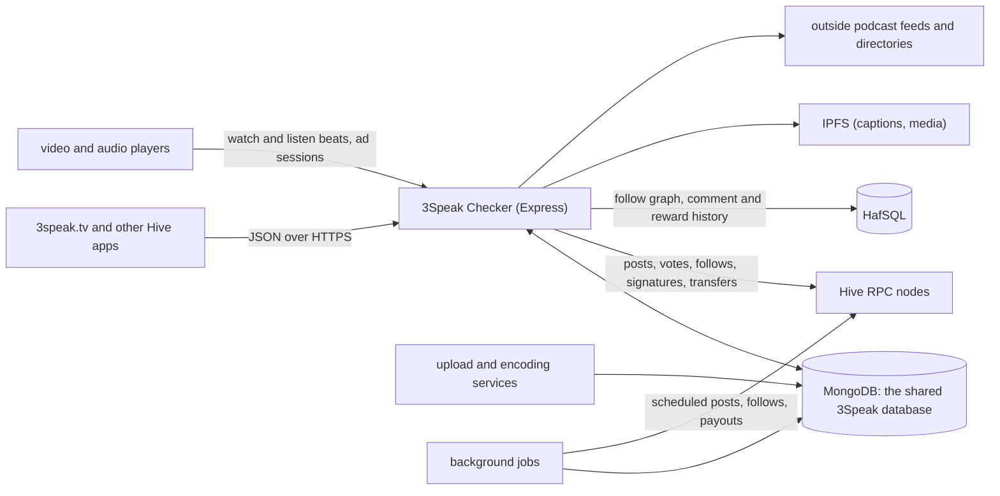

<h1 align="center">3Speak Checker</h1>

<p align="center">
  <strong>The backend API behind <a href="https://3speak.tv">3speak.tv</a>.</strong><br>
  Feeds, search, Shorts, audio and podcasts, creator stats, notifications and ads,<br>
  served from 3Speak's MongoDB and verified against Hive.
</p>

<p align="center">
  <a href="https://github.com/Mantequilla-Soft/3speakchecks/actions/workflows/tests.yml"></a>
  
  
  
  
  
  
</p>

---

Every 3Speak video, Short and audio post is a Hive post, but a video site cannot build
its home page out of raw Hive RPC calls: it needs ranked feeds, search, view counts,
watch history, per-viewer filters and creator analytics, fast. The checker is the
service that answers those questions. It reads the 3Speak database that the upload
and encoding pipeline writes, enriches it with Hive data (rewards, votes, follows,
reputation), ranks it, and serves it as a JSON API to 3speak.tv and to other Hive
apps that show 3Speak content.

It also does the work a frontend should not: it verifies Hive signatures and
transfers before writing anything that matters, runs the background jobs (trending,
retention scoring, syncs, scheduled posts, payouts), stitches ads into HLS playback,
and serves Podcast 2.0 RSS feeds.

The public instance is **https://checker.3speak.tv**. (Its old nickname, the Pancreas
API, survives in the root endpoint.)

## Contents

- [How it works](#how-it-works)
- [Quick start](#quick-start)
- [Configuration](#configuration)
- [Reference](#reference): [auth](#auth) · [health](#health) · [videos](#videos) · [feeds](#feeds) · [Shorts and stories](#shorts-and-stories) · [search](#search) · [users and channels](#users-and-channels) · [communities, snaps and playlists](#communities-snaps-and-playlists) · [audio](#audio) · [podcasts](#podcasts) · [RSS](#rss) · [creator tools](#creator-tools) · [creator stats](#creator-stats) · [tips, curation and leaderboards](#tips-curation-and-leaderboards) · [notifications](#notifications) · [advertising](#advertising) · [warm-up accounts](#warm-up-accounts) · [moderation, feedback and privacy](#moderation-feedback-and-privacy) · [service to service](#service-to-service)
- [Development and tests](#development-and-tests)
- [Repository layout](#repository-layout)
- [Security notes](#security-notes)
- [Contributing](#contributing)
- [License](#license)

## How it works



1. **Reads.** Most routes are reads over the collections the rest of 3Speak writes:
   `videos` (legacy uploads), `embed-video` (current uploads and Shorts),
   `embed-audio`, `embed-users`, `playlists`, `watch_history` and the watch and
   listen session data the players report. Feed list responses drop the post body to
   keep payloads small, and card stats (payout, votes, comments) can be stamped from
   the checker's own cache instead of one Hive call per card.
2. **Ranking.** Trending is recomputed every `TRENDING_INTERVAL_MIN` minutes from views,
   votes, comments, rewards and reshares. Discover, Interests and related videos rank
   by topic and by how much of a video people actually watch; [algo.md](algo.md)
   explains the retention score in detail.
3. **Writes that matter are proven.** A write either carries a Hive signature, carries a
   session vouch signed by 3Speak's posting delegate, or names something that the
   checker re-reads from Hive before storing (a post, a community, a transfer). See
   [Auth](#auth).
4. **Background jobs.** Each instance keeps its own in-memory pools warm (feed pools,
   engagement affinity, card stats, the podcast feed worker). Jobs that write shared data,
   broadcast to Hive or move money (trending flags, community and profile syncs,
   retention scoring, scheduled posts, ad and listener payouts, the verified-creator
   follow list) run only where `BACKGROUND_JOBS=true`. Replicas set it to `false` and
   only serve requests.

## Quick start

```bash
git clone https://github.com/Mantequilla-Soft/3speakchecks.git
cd 3speakchecks
npm install
cp .env.example .env    # then set MONGODB_URI and DATABASE_NAME at least
npm run dev             # nodemon on http://localhost:3000
```

```bash
curl http://localhost:3000/healthz
curl "http://localhost:3000/feeds/trending?limit=10"
curl http://localhost:3000/shorts/badadib
```

The checker expects a MongoDB that holds 3Speak's collections. Against an empty
database it starts and answers with empty lists. For local work against shared data,
set `BACKGROUND_JOBS=false` (no broadcasts, payouts or syncs) and, if you only want to
read, `ENABLE_MONGO_WRITES=false`.

`npm start` runs the server without the file watcher.

## Configuration

Settings are read from `.env` by [utils/config.js](utils/config.js), which documents
every option inline; [.env.example](.env.example) is the starting template. Most of the
several hundred options are tuning knobs with safe defaults. The ones that decide how
an instance behaves:

| Variable | Purpose | Default |
|---|---|---|
| `PORT` | HTTP port | `3000` |
| `MONGODB_URI` | MongoDB connection string | required |
| `DATABASE_NAME` | Database name | `threespeak` |
| `BACKGROUND_JOBS` | `false` makes a replica: serve requests, run no shared jobs | `true` |
| `CHECKER_INSTANCE` | Instance name reported by `/health/latency` | host name |
| `ENABLE_MONGO_WRITES` | `false` refuses route writes and skips trending writes | `true` |
| `MAINTENANCE_MODE` | `true` makes `/healthz` report maintenance | `false` |
| `HIVE_RPC_ENDPOINTS` | Hive API nodes, comma separated, tried in order | `techcoderx.com`, `api.deathwing.me`, `api.hive.blog` |
| `HIVE_AUTH_REQUIRED` | Enforce Hive signatures on signed routes (link verification, scheduled posts, ad applications) | `true` |
| `SIGNATURE_TIMESTAMP_TOLERANCE_MS` | How old a signed request may be | `300000` (5 min) |
| `AD_SIGNING_DELEGATES` | Accounts whose posting key may sign vouches and delegate signatures | `threespeak` |
| `HAFSQL_HOST` and related | HafSQL database (follow graph, comment inbox, earnings) | the public HafSQL service |
| `IPFS_API_URL` | IPFS node for caption edits and the subtitle proxy | `http://127.0.0.1:5001` |
| `TRENDING_INTERVAL_MIN` | Minutes between trending recalculations | `15` |
| `TRENDING_*_WEIGHT` | Trending weights for views, votes, comments, rewards, reshares | `1`, `2`, `3`, `10`, `5` |
| `SHORT_SORT_INTERVAL`, `REWARD_WEIGHT` | Bucket size (days) and reward weight of `/shortssorted` | `2`, `0.7` |
| `VIDEO_STATS_ENABLED` | Stamp card stats on feed items from the checker's cache | `false` |
| `ADS_STAGE` | Ads surface: `off`, `beta` or `public` | `beta` |
| `AD_PAYOUTS_ENABLED` | Run ad payout periods (dry runs until `AD_PAYOUT_ACTIVE_KEY` is set) | `false` |
| `LIVE_NOTIFY_ENABLED` | "Went live" notifications | `false` |
| `PULSE_HOTSET_ENABLED` | Serve `GET /pulse/hot-set` | `false` |
| `PUSH_REQUIRE_PROOF` | Require a session vouch to save push preferences | `false` |
| `VAPID_PUBLIC_KEY`, `VAPID_PRIVATE_KEY`, `VAPID_SUBJECT` | Web push keys | unset (push off) |
| `API_SECRET_KEY` | The app key sent by the frontend on the `app key` routes (not a secret, see [Security notes](#security-notes)) | unset |
| `UPLOAD_SECRET_TOKEN` | Token for `PATCH /api/video/:owner/:permlink/reusable` | unset |
| `AD_ADMIN_SECRET` | Operator secret for the ads and Shorts challenge admin routes | unset (503) |
| `GDPR_ADMIN_SECRET` | Operator secret for `/gdpr-admin/*` | unset (503) |
| `STREAM_STATS_SECRET` | Shared secret of the live-stream service for `/stream-stats/*` | unset (503) |
| `PULSE_API_KEY` | Key Video Pulse sends to `/pulse/hot-set` | unset (401) |
| `PUSH_ADMIN_KEY` | Key for `POST /push/test` | unset (403) |
| `IP_HASH_SECRET`, `PODCAST_ART_SECRET`, `LISTEN_BEAT_KEY` | Server-side HMAC secrets (hashed IPs, art tokens, listen beats) | optional |
| `AD_PAYOUT_ACTIVE_KEY`, `PPL_PAYOUT_ACTIVE_KEY`, `THREESPEAK_PRO_POSTING_KEY`, `VERIFIED_BADGE_POSTING_KEY` | Hive keys for payouts and broadcasts; only on the instance that runs them | unset |

## Reference

Every route returns JSON unless noted. Paths are relative to the server root
(`https://checker.3speak.tv` for the public instance). List routes generally take
`page` and `limit` (most cap `limit` at 100), and personalised feeds take
`currentuser=<hive account>` to apply that viewer's hides and history, and `nsfw=true`
to include NSFW content. The full parameter list of a route is in the comment above it
in `routes/`.

### Auth

| Mark | Meaning |
|---|---|
| none | Public |
| `signed` | Hive signature under the account's posting authority (its own key, or a delegate in `AD_SIGNING_DELEGATES`) over a message the server builds from the request, with a `timestamp`. The message format is documented at the top of each route file. |
| `vouch` | Session vouch: `{ user, signature, timestamp }` signed by a 3Speak posting delegate for a session it verified, valid for 24 hours. Proves who is asking, for personal reads and low-stakes personal state. |
| `chain` | No signature, but the request only names something (a post, a community, a transfer) that the checker reads back from Hive before storing anything. |
| `user` | The caller names its own account, unproven. Only for personal, low-stakes preferences that remove content from the caller's own feeds. |
| `app key` | `Authorization: Bearer <API_SECRET_KEY>`. A client identifier, not authentication. |
| `upload token` | `Authorization: Bearer <UPLOAD_SECRET_TOKEN>` |
| `reference` | The advertiser's opaque application reference |
| `session` | The ad or listen session id and token handed out by the session route |
| `ads admin` | `Authorization: Bearer <AD_ADMIN_SECRET>` (or `X-Admin-Secret`) |
| `gdpr admin` | `Authorization: Bearer <GDPR_ADMIN_SECRET>` (or `X-Admin-Secret`) |
| `stream secret` | `Authorization: Bearer <STREAM_STATS_SECRET>` (or `X-Api-Key`) |
| `pulse key` | `Authorization: Bearer <PULSE_API_KEY>` |
| `push admin` | `X-Admin-Key: <PUSH_ADMIN_KEY>` |
| `loopback` | Only from the same machine, with no proxy headers; anything else gets 404 |

### Health

| Method | Path | Auth | Purpose |
|---|---|---|---|
| GET | `/` | | Status and a short list of the original endpoints |
| GET | `/healthz` | | Liveness for the frontend's maintenance gate: always 200 with `ok` |
| GET | `/health/latency` | | Instance name, primary flag and database round trip, for picking the fastest instance |

### Videos

| Method | Path | Auth | Purpose |
|---|---|---|---|
| GET | `/videodetails/:author/:permlink` | | Full details of one video |
| GET | `/api/video/:owner/:permlink` | | Video details (with the `reusable` flag) from `videos` or `embed-video` |
| PATCH | `/api/video/:owner/:permlink/reusable` | `upload token` | Set the reusable flag |
| GET | `/videos/tag/:tag` | | Videos with a tag, newest first |
| GET | `/videos/tag/:tag/counts` | | Counts only for a tag |
| POST | `/views` | | View counts for up to 50 `{ author, permlink }` pairs |
| GET | `/transcription-tags/:author/:permlink` | | Tags the transcription pipeline assigned |
| POST | `/transcription-tags/ai-batch` | | Which of up to 200 videos are flagged AI-generated |
| PUT | `/video/thumbnail` | `app key` | Change a video's thumbnail |
| PUT | `/video/listing` | `app key` | List or unlist a video on 3Speak (it stays playable by link) |
| PUT | `/video/nsfw` | `app key` | Mark or clear NSFW |
| PUT | `/video/openpod` | `app key` | Mark an upload as a live-stream recording |
| POST | `/video/reinstate` | `app key` | Clear the "unavailable" state after a source file is replaced |
| POST | `/video/report-unavailable` | | Report a video that does not play; checked against the gateways before it is hidden |
| GET | `/video/unavailable-stats` | | How many videos are currently hidden as unavailable |

### Feeds

| Method | Path | Auth | Purpose |
|---|---|---|---|
| GET | `/feed/:username` | | Videos from accounts the user follows on Hive |
| GET | `/feeds/recommended` | | Curated videos |
| GET | `/feeds/new` | | New uploads from established creators |
| GET | `/feeds/firstUploads` | | Videos from first-time creators |
| GET | `/feeds/trending` | | Videos flagged trending by the scheduled job |
| GET | `/feeds/trendingSorted` | | Trending ranked by score, with reshare influence |
| GET | `/feeds/promoted` | | Videos with an active paid promotion |
| GET | `/feeds/discover` | | Discovery ranked by interests and retention, not popularity |
| GET | `/feeds/interests` | | The Interests row, from its own topic pool |
| GET | `/feeds/related/:author/:permlink` | | Sidebar recommendations for a watch page |
| GET | `/feeds/new-from-following` | | Followed creators with recent videos the viewer has not watched |
| GET | `/feeds/suggested-creators` | | Creators to follow, from recent interest-matching videos |
| GET | `/feeds/creator-gated/:username` | | A creator's supporters-only videos |
| GET | `/feeds/community/:id/new` | | A Hive community's newest videos |
| GET | `/feeds/community/:id/trending` | | A community's trending videos |
| GET | `/feeds/community/:id/top` | | A community's most viewed videos over `7d`, `30d`, `365d` or `all` |
| GET | `/feeds/communities/activity` | | Today and this week per community, for the directory cards |
| GET | `/feeds/stream-vods` | | Recordings of finished live streams |
| GET | `/feeds/watched/:username` | | A viewer's watch history as feed cards |
| POST | `/feeds/continue-watching` | `vouch` | The viewer's Continue watching strip |
| POST | `/feeds/continue-watching/hide` | `vouch` | Hide or restore one item on that strip |

### Shorts and stories

| Method | Path | Auth | Purpose |
|---|---|---|---|
| GET | `/shorts` | | Published Shorts, newest first (`app=` filters by frontend app) |
| GET | `/shortssorted` | | Shorts ranked by reward, recency and a seeded shuffle (reuse `seed` across pages) |
| GET | `/shorts/:username` | | All Shorts by one account |
| GET | `/shorts/stories` | | Creators with unseen Shorts from the last few days |
| GET | `/stories` | | Creators with a live 24-hour story |
| GET | `/stories/following` | | Live stories from accounts the viewer follows |
| GET | `/stories/streak/:user` | | A creator's story streak in days |
| GET | `/stories/seen` | | Who watched a story |
| POST | `/stories/register` | `chain` | Mirror a post's story flag onto its upload |
| POST | `/stories/keep` | `signed` | The author keeps a live story as an ordinary Short |
| GET | `/sounds/trending` | | Sounds most used by recent Shorts |
| GET | `/sounds/:id` | | One sound and the Shorts that use it |
| GET | `/shorts-challenges` | | This week's Shorts challenge, next week's and past weeks |
| GET | `/shorts-challenges/:week` | | One challenge week (`2026-W48`) |
| GET | `/shorts-challenges/:week/entries` | | A week's checked entries |
| GET | `/admin/shorts-challenges` | `ads admin` | Challenge weeks for the team |
| PUT | `/admin/shorts-challenges/:week` | `ads admin` | Set a week's challenge |
| GET | `/admin/shorts-challenges/:week/entries` | `ads admin` | All entries of a week, for review |
| PUT | `/admin/shorts-challenge-entries/:owner/:permlink` | `ads admin` | Check or reject one entry |

### Search

| Method | Path | Auth | Purpose |
|---|---|---|---|
| GET | `/search` | | Full-text search; `type` is `video`, `short`, `audio`, `community`, `user`, `playlist` or `all` |
| GET | `/search/suggest` | | Autocomplete |

### Users and channels

| Method | Path | Auth | Purpose |
|---|---|---|---|
| GET | `/check/:username` | | Whether an account may upload (`banned`, `canUpload`) |
| GET | `/gethive/:user_id` | | Hive account of a legacy 3Speak user id |
| GET | `/getjobid/:owner/:permlink` | | Encoding job id of a legacy video |
| GET | `/api/my-videos` | | An account's uploads (`username=`), with status filters |
| GET | `/user/:username/counts` | | Profile counts (videos, Shorts, views) |
| POST | `/users/counts` | | The same for up to 100 accounts |
| GET | `/user/:username/trailer` | | A channel's trailer video |
| PUT | `/user/trailer` | `app key` | Set or clear the trailer |
| GET | `/premium/:username` | | Whether an account has 3Speak Pro |
| GET | `/premium` | | All current Pro accounts |
| POST | `/check-hidden` | | Which of these accounts are hidden or muted |
| POST, DELETE | `/user/hide-video` | `user` | "Not interested": hide one video from the caller's feeds |
| POST, DELETE | `/user/hide-creator` | `user` | Hide every video by a creator from the caller's feeds |
| GET | `/user/hidden/:username` | | What an account has hidden |
| POST | `/viewer-tag` | `user` | Record a viewer's topic tag for a video |
| GET | `/viewer-tag/mine/:username/:author/:permlink` | | Whether this viewer already tagged the video |
| GET | `/viewer-tags/:author/:permlink` | | Combined topic tags of a video |
| GET | `/verify/platforms` | | Platforms an account can link (YouTube, SoundCloud, RSS and others) |
| GET | `/verify/hash/:hive_username` | | The code to place in the outside profile |
| GET | `/verify/check` | `signed` | Verify a linked outside account |
| GET | `/verify/unlink` | `signed` | Remove a link, once the code is gone from the profile |
| GET | `/verify/links/:hive_username` | | An account's verified links |
| GET | `/galaxy/lists` | | An account's following and followers (from HafSQL) |
| GET | `/galaxy/scan` | | Follow graph around an account, for the galaxy page |

### Communities, snaps and playlists

| Method | Path | Auth | Purpose |
|---|---|---|---|
| GET | `/community/:name` | | Full metadata of a Hive community (about, description, rules) |
| GET | `/communities/search` | | Search communities |
| POST | `/community/created` | `chain` | Index a newly created community right away |
| POST | `/snaps` | `chain` | Index a written community post (snap) after reading it from Hive |
| GET | `/snaps/:owner` | | An account's snaps |
| GET | `/snaps/community/:id` | | Snaps filed under a community |
| GET | `/snaps-feed` | | Fresh snaps for the home feed (`scope=all` or `following`) |
| POST | `/snaps/interaction` | `user` | The viewer voted or commented on a snap; stop surfacing it |
| POST, DELETE | `/snaps/hide` | `user` | Hide or unhide one snap |
| POST, DELETE | `/snaps/hide-creator` | `user` | Hide or unhide a creator's snaps |
| POST | `/polls/vote` | `vouch` | Vote in a snap poll (one vote per account) |
| POST | `/polls/results` | | Tallies of several polls (`mine` too with a vouch) |
| GET | `/polls/creator/:owner` | | A creator's polls and tallies |
| GET | `/playlists-feed` | | Recently changed public playlists for the home feed |
| GET | `/badges` | | Hive badge directory |
| GET | `/badges/:account` | | One badge and its counts |
| GET | `/badges/:account/recipients` | | Who holds a badge |
| GET | `/badges/:account/feed` | | Videos by a badge's holders |
| GET | `/badges/by-creator/:creator` | | Badges an account can award |
| POST | `/badges/created` | `chain` | Index a new badge account |

### Audio

| Method | Path | Auth | Purpose |
|---|---|---|---|
| GET | `/audio` | | Audio posts, with filters |
| GET | `/audio/grouped` | | Audio grouped by category |
| GET | `/audio/categories` | | Categories with counts |
| GET | `/audio/tags` | | Top tags |
| GET | `/audio/auto-tags` | | Top tags generated from transcripts |
| GET | `/audio/creators` | | Audio creators |
| GET | `/audio/playlists` | | Public music playlists, by the artist or by listeners |
| GET | `/audio/:permlink/subtitles` | | Subtitles of a track |
| POST | `/audio/resync` | `app key` | Re-read an edited post's title from Hive |
| POST | `/audio/play-start` | | Open a measured play session |
| POST | `/audio/play-beat` | `session` | Heartbeat while it plays |
| POST | `/audio/listen/start` | | Open a listening session for 3Speak audio or a podcast episode (a vouch names the listener) |
| POST | `/audio/listen/beat` | `session` | Listening heartbeat |
| GET | `/audio/listen/heatmap` | | The "most replayed" curve of one item |

### Podcasts

Outside podcast feeds, behind the Podcasts tab on 3speak.tv/audio. Private (paid or
password protected) feeds are never listed, and reading their episodes needs the
listener's vouch as `vu`, `vts` and `vsig` query parameters.

| Method | Path | Auth | Purpose |
|---|---|---|---|
| GET | `/podcasts/config` | | Client settings |
| GET | `/podcasts/subscriptions` | | The shows a user follows (`user=`) |
| GET | `/podcasts/latest` | | Newest episodes of everything a user follows |
| GET | `/podcasts/notifications` | | New episodes since each follow |
| GET | `/podcasts/feed/:id` | | A show and its newest episodes |
| GET | `/podcasts/feed/:id/older` | | The next page of episodes |
| GET | `/podcasts/episode/:id` | | One episode |
| GET | `/podcasts/episode/:id/notes` | | Full show notes |
| GET | `/podcasts/episode/:id/chapters` | | Chapters |
| GET | `/podcasts/episode/:id/transcript` | | Transcript as timed cues |
| GET | `/podcasts/episode/:id/download` | | The audio through the checker, for saving offline |
| GET | `/podcasts/search` | | Search Podcast Index, Apple Podcasts and fyyd |
| GET | `/podcasts/person` | | Shows a host or guest appears in |
| GET | `/podcasts/trending` | | Podcast Index trending shows |
| GET | `/podcasts/charts` | | Apple Podcasts top charts |
| GET | `/podcasts/discover` | | Most and recently followed shows on 3Speak |
| GET | `/podcasts/art/:token/:px.jpg` | | Cover art |
| GET | `/podcasts/progress` | | How far a user got in episodes |
| POST | `/podcasts/progress` | `vouch` | Save listening progress |
| POST | `/podcasts/progress/recent` | `vouch` | The user's Continue listening list |
| POST | `/podcasts/progress/hide` | `vouch` | Hide or restore one item on it |
| POST | `/podcasts/subscribe` | `signed` or `vouch` | Follow shows |
| POST | `/podcasts/unsubscribe` | `signed` or `vouch` | Unfollow a show |
| POST | `/podcasts/notify` | `signed` or `vouch` | Episode notifications on or off for a show |
| POST | `/podcasts/resolve` | `signed` or `vouch` | Check a show before adding it to a playlist |
| POST | `/podcasts/bundle` | | The outside shows a 3Speak playlist names, episodes merged by date |
| GET | `/podcasts/verified` | | Shows a Hive account proved it publishes |
| GET | `/podcasts/verified/:user/episode/:id/download` | | Audio of one of those episodes, for the podcast import |

### RSS

Podcast 2.0 feeds and their assets. Not JSON.

| Method | Path | Auth | Purpose |
|---|---|---|---|
| GET | `/rss/:username.xml` | | A channel's feed |
| GET | `/rss/playlist/:id.xml` | | A public playlist's feed, with episodes of the outside shows it names |
| GET | `/rss/playlist/:id/card.json` | | Link preview data for a playlist |
| GET | `/rss/cover/user/:username.jpg` | | Square channel cover |
| GET | `/rss/cover/playlist/:id.jpg` | | Square playlist cover |
| GET | `/rss/cover/episode/:owner/:permlink.jpg` | | Episode art |
| GET | `/rss/chapters/:owner/:permlink.json` | | Chapters, Podcast Namespace JSON |
| GET | `/rss/transcript/:owner/:permlink/:lang.srt` | | Captions as SRT (`.vtt` for WebVTT) |
| GET | `/rss/transcript/:owner/:permlink.txt` | | The transcript written into the post |

### Creator tools

| Method | Path | Auth | Purpose |
|---|---|---|---|
| GET | `/scheduled-posts/:username` | | An account's scheduled posts and drafts |
| POST | `/scheduled-posts/create` | `app key` + `signed` | Queue a post or save a draft |
| POST | `/scheduled-posts/update` | `app key` + `signed` | Edit a queued post or draft |
| POST | `/scheduled-posts/publish` | `app key` + `signed` | Turn a draft into a scheduled post |
| POST | `/scheduled-posts/cancel` | `app key` + `signed` | Cancel a queued post |
| GET | `/publish-quota/:owner` | | The daily publish limit for `kind=video` or `short` |
| GET | `/premieres/upcoming` | | Upcoming and live premieres |
| GET | `/premieres/:owner/:permlink` | | One premiere |
| POST | `/premieres/reminders` | `vouch` | The viewer's premiere reminders |
| POST | `/premieres/:owner/:permlink/remind` | `vouch` | "Notify me" on or off |
| GET | `/premieres/:owner/:permlink/chat` | | Premiere chat messages (polled) |
| POST | `/premieres/:owner/:permlink/chat` | `vouch` | Send a chat message while live |
| POST | `/premieres/:owner/:permlink/chat/remove` | `vouch` | Remove a message (its author or the creator) |
| POST | `/subtitles/edit` | `signed` | The author corrects or adds captions; stored on IPFS |
| GET | `/subtitle-proxy/:cid` | | Same-origin proxy for a caption file |
| POST | `/comments/pin` | `signed` | The author pins or unpins comments on their video |
| POST | `/collabs/register` | `chain` | Open invites for the co-creators a post names |
| POST | `/collabs/respond` | `vouch` | Accept or decline a collab |
| POST | `/collabs/mine` | `vouch` | The caller's collab invites |
| GET | `/collabs/post/:author/:permlink` | | Accepted co-creators of a post |
| POST | `/derived/register` | `chain` | Index a post made from another (clip, audiogram, remix, reaction) |
| GET | `/derived/:author/:permlink` | | What was made from a post |
| POST | `/creator-inbox` | `vouch` | Comments left for the creator |
| POST | `/creator-inbox/done` | `vouch` | Mark an inbox comment done |
| POST | `/creator-stats/clip-ideas` | `vouch` | Suggested Short clips from the owner's long video |

### Creator stats

The first nine routes below also answer under `/analytics/` (for example
`/analytics/overview`).

| Method | Path | Auth | Purpose |
|---|---|---|---|
| GET | `/creator-stats/overview` | | Totals and best performing videos (`username`, `days`) |
| GET | `/creator-stats/timeseries` | | Daily watch time and views |
| GET | `/creator-stats/weekly-top` | | Top videos by watch time per week |
| GET | `/creator-stats/video` | | One video's retention and most replayed parts (`kind=audio` for audio) |
| GET | `/creator-stats/demographics` | | Countries, devices and time of day |
| GET | `/creator-stats/has-data` | | Whether a video has any watch data |
| GET | `/creator-stats/follows` | | Who started following, and whom the account followed |
| GET | `/creator-stats/hive-year` | | Data for the yearly recap |
| GET | `/creator-stats/ad-income` | | Paid ad income by kind |
| GET | `/creator-stats/earnings` | | Earnings per day by source (votes, curation, tips, ads, boosts, Lightning) |
| GET | `/creator-stats/reach` | | Card impressions, opens and where viewers found a video |
| POST | `/reach/seen` | | Cards seen, sampled, from the frontend |
| POST | `/reach/open` | | A video opened, and from which surface |

### Tips, curation and leaderboards

| Method | Path | Auth | Purpose |
|---|---|---|---|
| POST | `/supports/record` | `chain` | Record a tip after finding the real transfer in the tipper's Hive history |
| GET | `/supports/:author` | | Tips to a creator |
| GET | `/supports/:author/supporters` | | A creator's supporters, biggest first |
| GET | `/supports/by/:tipper` | | Tips an account sent |
| GET | `/supports/by/:tipper/supported` | | Creators an account supported |
| POST | `/supports/hide` | `signed` | The creator hides or shows a tip |
| GET | `/boosts/:author/:permlink` | | A post's boost wall |
| GET | `/curation/:user` | | A voter's curation picks and rewards on 3Speak |
| POST | `/curation/vote` | `vouch` | Report a vote just broadcast from 3Speak |
| GET | `/promote/quote` | | Price and recipient for paid promotion |
| GET | `/promote/status/:author/:permlink` | | A video's promotion status |
| PUT | `/promote/claim` | `app key` | Claim a promotion; the payment is verified on Hive |
| GET | `/leaderboard` | | One ranked board (`window`, `metric`) |
| GET | `/leaderboard/summary` | | Top N of every metric for a window |
| GET | `/leaderboard/user/:username` | | A creator's stats and ranks |
| GET | `/leaderboard/topics` | | Topics with a leaderboard |
| GET | `/leaderboard/topic` | | One topic's leaderboard |
| GET | `/leaderboard/badges/:username` | | Rank badges for a profile |

### Notifications

| Method | Path | Auth | Purpose |
|---|---|---|---|
| GET | `/push/vapid-key` | | Public key a browser needs to subscribe |
| POST | `/push/subscribe` | `user` | Register a browser for web push |
| POST | `/push/unsubscribe` | `user` | Remove one browser (all browsers needs a `vouch`) |
| GET | `/push/prefs` | | An account's push preferences |
| POST | `/push/prefs` | `user` or `vouch` | Save them (`vouch` required when `PUSH_REQUIRE_PROOF=true`) |
| POST | `/push/test` | `push admin` | Send a test notification |
| POST | `/notify/levels` | `vouch` | Notification level per followed creator |
| POST | `/notify/level` | `vouch` | Set one (`all`, `highlights`, `off`) |
| POST | `/notify/feed` | `vouch` | The bell's notification feed |
| GET | `/announcements/latest` | | The newest announcement for everybody |
| POST | `/announcements/latest` | `vouch` | The same, plus one addressed to the caller |
| POST | `/announcements/:number/replies` | optional `vouch` | Reply to an announcement that allows replies |

### Advertising

Self-serve ads on 3Speak. `ADS_STAGE=off` turns every non-admin route here into a 404.
Bookings are paid by a Hive transfer that the checker verifies itself, so nothing in
a request body counts as payment.

| Method | Path | Auth | Purpose |
|---|---|---|---|
| GET | `/advertise/access/:account` | | Whether an account may use the ad surfaces yet |
| GET | `/advertise/has-product/:account` | | Whether an account is an advertiser |
| GET | `/advertise/inventory` | | Audience figures and deliverable slots |
| POST | `/advertise/apply` | `signed` | Apply as an advertiser; returns a reference |
| GET | `/advertise/application/:reference` | `reference` | Application status |
| POST | `/advertise/mine` | `signed` or `vouch` | All applications of an account |
| POST | `/advertise/branding` | `reference` | Set the advertiser's name, logo and slogan |
| POST | `/advertise/product/discard` | `reference` | Withdraw a pending application |
| GET | `/advertise/pricing` | | Rate card and where to pay |
| GET | `/advertise/slots` | | What is for sale in a window |
| GET | `/advertise/forecast` | | Plays a booking would be quoted, before it is made |
| POST | `/advertise/campaigns` | `reference` | Create a flight |
| GET | `/advertise/campaigns` | `reference` | The advertiser's campaigns |
| POST | `/advertise/campaigns/:id/creative` | `reference` | Attach an uploaded spot |
| POST | `/advertise/campaigns/:id/audio` | `reference` | Attach an audio spot |
| POST | `/advertise/campaigns/:id/claim` | `reference` | Verify the payment on Hive and schedule the flight |
| POST | `/advertise/creatives` | `reference` | Submit a spot for review before booking |
| GET | `/advertise/creatives` | `reference` | The advertiser's spots |
| POST | `/advertise/creatives/audio` | `reference` | Submit an audio spot |
| POST | `/advertise/creatives/listen` | `reference` | Hear a spoken ticker before saving it |
| GET | `/advertise/selfpromo/options` | | Whether a creator's own video can run as an ad, and the price |
| POST | `/advertise/selfpromo/book` | | Book that flight (inert until paid through `/claim`) |
| GET | `/advertise/creator/prefs/:account` | | Whether a creator carries ads |
| POST | `/advertise/creator/prefs` | `signed` | A creator's ad opt-out and settings |
| POST | `/advertise/creator/video-ads/sync` | `chain` | Copy a video's "ads on this video" choice from its Hive post |
| POST | `/advertise/creator/audio-ads/sync` | `chain` | The same for an audio post |
| GET | `/advertise/viewer/prefs/:account` | | Whether a viewer opted into viewer rewards |
| POST | `/advertise/viewer/prefs` | `signed` | Opt in or out of viewer rewards |
| POST | `/advertise/listener/prefs` | `signed` | Opt in or out of listener rewards |
| GET | `/advertise/admin/applications` | `ads admin` | Application queue |
| POST | `/advertise/admin/applications/:id/decide` | `ads admin` | Approve or reject an application |
| GET | `/advertise/admin/creatives` | `ads admin` | Creative review queue |
| POST | `/advertise/admin/creatives/:id/decide` | `ads admin` | Approve or reject a spot |
| GET | `/advertise/admin/inventory` | `ads admin` | Full inventory snapshot |
| POST | `/advertise/admin/inventory/refresh` | `ads admin` | Rebuild it |
| GET, POST | `/advertise/admin/rates` | `ads admin` | Platform rates per format |
| GET | `/advertise/admin/advertisers/rates` | `ads admin` | Advertisers whose rates differ from the platform's |
| GET, POST | `/advertise/admin/advertisers/:id/rates` | `ads admin` | One advertiser's rates |
| GET | `/advertise/admin/refunds` | `ads admin` | Refused payments to send back |
| POST | `/advertise/admin/refunds/:trxId/settle` | `ads admin` | Record a refund with its Hive transaction id |

Ad delivery is server-side: the spot is stitched into the HLS playlist the player
already asked for. It lives under `/m`, a path that reads like ordinary streaming.

| Method | Path | Auth | Purpose |
|---|---|---|---|
| POST | `/m/session` | | Decide whether an ad runs and open a session; returns a manifest URL |
| GET | `/m/:sid.m3u8` | `session` | The stitched playlist |
| GET | `/m/:sid/:n` | `session` | A measured segment (redirect to the CDN) |
| GET | `/m/:sid/s/:vk/:i` | `session` | A segment with a banner burned in |
| GET | `/m/:sid/short.m3u8` | `session` | A Shorts spot's own playlist |
| GET | `/m/:sid/i` | `session` | Where the break landed |
| POST | `/m/:sid/w` | `session` | Seconds of the spot actually watched |
| POST | `/m/:sid/skipped` | `session` | The viewer skipped |
| GET | `/m/:sid/c`, `/m/:sid/bc`, `/m/:sid/tc` | `session` | Click-through of the spot, banner or ticker |
| POST | `/m/:sid/banner-shown`, `/m/:sid/ticker-shown` | `session` | An overlay banner or ticker was displayed |
| POST | `/m/:sid/dismiss` | `session` | The viewer closed the banner |
| POST | `/m/:sid/posted` | `session` | Complete a pre-upload spot once the upload exists |
| GET | `/m/tts/:file` | | A spoken ticker's audio |

### Warm-up accounts

People who use 3Speak before they have a Hive account. Their content lives in a hosted
incubation service; these routes pass reads through to it.

| Method | Path | Auth | Purpose |
|---|---|---|---|
| POST | `/incubation/authors` | | Handles to identities, in bulk |
| GET | `/incubation/profile/:handle` | | Profile, interests and counts |
| GET | `/incubation/user/:handle/posts` | | One user's posts |
| GET | `/incubation/post/:handle/:permlink` | | One off-Hive post |
| GET | `/incubation/feed` | | Warm-up content for the feeds |
| GET | `/incubation/review` | | Warm-up posts by review state |
| GET | `/incubation/replies` | | Off-Hive replies under one post |
| POST | `/incubation/replies/for` | | The same for many posts |
| GET | `/incubation/likes` | | 3Speak likes of one post |
| POST | `/incubation/likes/for` | | The same for many posts |
| GET, PUT | `/incubation/internal/contact/:userId` | `loopback` | Contact details a user gave |
| GET | `/incubation/internal/contact-by-handle/:handle` | `loopback` | The same, by handle |
| GET | `/incubation/internal/watch/:handle` | `loopback` | Seconds watched |
| GET | `/incubation/internal/listen/:handle` | `loopback` | Seconds listened |
| GET | `/incubation/internal/audio/:handle` | `loopback` | Audio upload count |
| GET | `/incubation/internal/social/:userId` | `loopback` | Linked outside accounts |
| POST | `/incubation/internal/social/verify`, `/incubation/internal/social/unlink` | `loopback` | Link or unlink an outside account |
| POST | `/incubation/internal/claim-assets` | `loopback` | Move uploads to the Hive account the user graduated to |

### Moderation, feedback and privacy

| Method | Path | Auth | Purpose |
|---|---|---|---|
| POST | `/reports` | | Report a live stream into the moderation queue |
| POST | `/reviews` | | Product feedback, optionally with a private screenshot |
| POST | `/client-errors` | | Frontend page-error reports (no account name, no IP) |
| GET | `/gdpr-request/scope` | | What data is tied to an account |
| POST | `/gdpr-request` | | File a data export or deletion request |
| GET | `/gdpr-admin/requests` | `gdpr admin` | List requests |
| GET | `/gdpr-admin/export/:username` | `gdpr admin` | Export an account's data |
| POST | `/gdpr-admin/delete` | `gdpr admin` | Delete an account's data (`dryRun` supported) |
| POST | `/gdpr-admin/close` | `gdpr admin` | Mark a request fulfilled |

### Service to service

| Method | Path | Auth | Purpose |
|---|---|---|---|
| POST | `/stream-stats/viewer` | `stream secret` | A new viewer joined a live stream |
| POST | `/stream-stats/peak` | `stream secret` | New concurrent-viewer peak |
| POST | `/stream-stats/end` | `stream secret` | The stream ended |
| POST | `/stream-stats/boost` | `stream secret` | A boost message during a stream |
| POST | `/stream-stats/clips-ready` | `stream secret` | A stream's clips are cut; notify host and clippers |
| GET | `/stream-stats/:streamId` | `stream secret` | A stream's aggregate |
| GET | `/pulse/hot-set` | `pulse key` | Old videos people are watching again, for Video Pulse |

## Development and tests

```bash
npm run dev             # nodemon, restarts on change
npm start               # plain node
npm test                # the Jest suite
npm run test:coverage   # plus a coverage report in coverage/
npm run test:watch      # watch mode
npx jest tests/feeds    # one area
```

The suite needs Node.js 22 and nothing else: it starts its own throwaway MongoDB,
never reads `.env`, and refuses outbound network, so it is safe to run anywhere. It
covers routes, services and utils with a coverage ratchet in `jest.config.js`. See
[tests/README.md](tests/README.md) for how tests are written. The
[Tests workflow](.github/workflows/tests.yml) runs it on every pull request and every
push to `main`.

Two things to know when adding a route:

- **Mount it before `streamStatsRoutes`** in `server.js`. That router gates every request
  that reaches it, so a route mounted after it answers 401.
- **Larger bodies need their own parser.** The global JSON parser stops at 100 kB; a
  route that takes more mounts `express.json({ limit })` and is listed in
  `utils/jsonBody.js`.

Maintenance and backfill scripts live in [scripts/](scripts/README.md).

## Repository layout

```
.
├── server.js              # Express app: middleware, route mounts, background job schedule
├── routes/                # one router per area, see Reference
├── services/              # background jobs and workers: trending, retention, syncs, payouts, podcast polling
│   └── platforms/         # link verification adapters (YouTube, SoundCloud, TikTok, Instagram, BitChute, Rumble, RSS)
├── utils/                 # config, database, Hive RPC, signature checks, ranking, ads model
├── config/                # search-weights.json, search ranking weights
├── data/                  # seed data: comment mute list, Shorts challenge weeks
├── public/rss/            # XSL stylesheet so feeds render in a browser
├── scripts/               # maintenance, backfill and ad check scripts
├── tests/                 # Jest suite
├── deploy/                # deploy tooling for the production instances
├── nginx/                 # example reverse proxy config
├── .github/workflows/     # tests.yml (CI) and deploy.yml
├── algo.md                # how the retention ranking works
├── WATCH-REWARDS-PLAN.md  # parked design for viewer watch-time rewards
├── .env.example           # configuration template
└── jest.config.js
```

## Security notes

- **The app key is not a secret.** `API_SECRET_KEY` is sent by the 3speak.tv frontend
  from the browser, so anyone can read it from the bundle. It identifies the client
  and nothing more: treat every route marked `app key` as callable by anyone, and put
  real protection (a Hive signature, a vouch, or a check on Hive) on anything new.
  Scheduled posts already require a signature on top of it, and promotion claims are
  checked against the Hive transfer.
- **Signatures are bound to the request.** The server builds the signed message from
  the request itself (action, account, target, timestamp), so a signature for one
  action cannot be replayed for another, and old ones expire after
  `SIGNATURE_TIMESTAMP_TOLERANCE_MS`. Delegate signatures are accepted only from
  `AD_SIGNING_DELEGATES`, which is what lets HiveSigner and Butter Auth users, who hold
  no key in the browser, act on their own account.
- **Money is verified on Hive.** Ad bookings, promotions and tips are recorded only
  for a real transfer the checker finds itself, with each transaction id counted once.
  Nothing in a request body is taken as proof of payment.
- **Operator routes fail closed.** The ads admin, GDPR admin, stream stats and Pulse
  secrets are compared in constant time, and when one is unset its routes refuse every
  request instead of opening up.
- **`user` routes are unproven by design.** Hides, viewer tags and push subscriptions
  take the caller's word for its own account because they only change what that
  account sees. Do not reuse that pattern for anything that writes public state.
- **Only one instance should broadcast.** Payouts, scheduled posts and follow
  broadcasts run where `BACKGROUND_JOBS=true`. Ad payouts are off until
  `AD_PAYOUTS_ENABLED=true`, and stay dry runs without `AD_PAYOUT_ACTIVE_KEY`. Run every
  other instance with `BACKGROUND_JOBS=false`, and keep Hive keys only where they are used.

## Contributing

Issues and pull requests are welcome. Questions and ideas go to the
[3Speak Discord](https://discord.gg/NSFS2VGj83).

## License

[MIT](LICENSE) © Mantequilla Soft.
